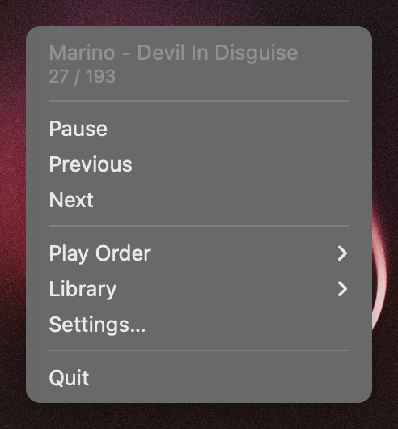

# Barplayer

A macOS menu bar player for one folder of local music.

Built with [MyGo](https://mygo.egoist.dev/) (native UI, no webview, no cgo): a few megabytes of binary, no Dock icon, and no window until you open one.

English · [简体中文](README_zh.md)

## Why it exists

- The music sits in a folder. No library to maintain.
- Add a file or delete one and the playlist follows by itself (file watching, not polling).
- Two clicks in the menu bar change the track, without digging a window out.
- When the next-track button is not enough, **Search…** opens a list of every track with the cursor in a search field: type part of a name, or scroll and click one.
- The keyboard's media keys, Control Center and global shortcuts all work, so writing something does not mean switching apps.

## Interface



Play / Pause, Previous, Next and Search show their global shortcut on the right, drawn by macOS (`⌥P`, `⌥[`, `⌥]`, `⌥\`). A shortcut left empty shows nothing there.

The first row names the track that plays, with its place in the list under it. That row opens a submenu: **Dislike** and **Reveal in Finder**. Both act on the track that plays, and neither sits where a slip of the mouse reaches Play / Pause.

### Search window

The window under **Search…** lists the whole folder. It opens with the field focused and the list at the track that plays, and it stays open: closing it hides it, and the app keeps running in the menu bar.

- Matching is a case-insensitive substring of the track name, filtered as you type.
- A click plays a track at once; `↩` in the field plays the highlighted row, the first match.
- With the field empty the highlight follows the track that plays, from the menu's next and previous too. Once a query is typed, the highlight is yours.
- Tracks inside a subfolder show the folder under the name, so two files of the same name tell apart.
- The field keeps the keyboard after a click, so typing always filters.
- `⌘W` or the close button hides the window; the shortcut opens it again, and hides it again while it shows.

## Library

- Only these extensions: `.mp3` `.flac` `.m4a` `.aac` `.ogg` `.oga` `.wav`.
- Sorted by full path, so the tracks of one subfolder stay together.
- **Include Subfolders** is off by default: on, it walks the folders inside and watches them too; off, only the top level counts.
- Watching uses FSEvents (`mygo.WatchFiles`). Events are coalesced for 50 ms before they arrive, and each batch rereads the folder. Rereading 214 files costs far less than keeping an incremental diff.
- Files and folders whose names start with a dot are ignored, and so is `_dislike`.
- **Dislike** moves the track that plays into `_dislike` at the top of the library folder, and the list moves on without it. Nothing is deleted: the files sit there in Finder, and dragging one back into the library makes it a track again. A track that was heard gives way to the next one; a paused one leaves the list without starting anything.
- When the folder is renamed or deleted the watch ends and the menu says **Folder unavailable**; pick the folder again.

## Settings

The window holds four things, none of them repeating the menu:

| Item | What it does |
| --- | --- |
| Language | System / 简体中文 / English. The switch applies at once, and the system remembers the choice |
| Shortcuts | Play/pause, previous, next, search: click a field to record, `Esc` cancels, `⌫` clears, and so does the circle on the right |
| Start at login | Off by default. macOS 13 and later needs a packaged app; under `go tool mygo dev` it does nothing |
| Show track name in the menu bar | Off by default. On, the title sits beside the icon, cut at 24 characters |

Defaults: `⌥P` play/pause, `⌥[` previous, `⌥]` next, `⌥\` search. While recording, the app unregisters its global shortcuts first, so pressing a combination it already holds does not also play or change track. A combination the system or another app holds keeps the old value and shows a message in the window. `⌘W` hides the window frontmost, as its close button does.

## Download and install

Apple Silicon, macOS 12 or later.

1. Download the disk image from the [latest release](https://github.com/insv23/barplayer/releases/latest/download/barplayer-0.1.1-arm64.dmg).
2. Open it and drag **Barplayer** into `/Applications`.
3. Check the download against the checksum published with the release:

   ```sh
   shasum -a 256 ~/Downloads/barplayer-0.1.1-arm64.dmg
   ```

   The value must match `barplayer-0.1.1-arm64.dmg.sha256`.

4. **The app is not signed with a Developer ID and not notarized**, so macOS
   quarantines it and refuses the first launch. Remove the flag once:

   ```sh
   xattr -dr com.apple.quarantine /Applications/Barplayer.app
   ```

5. Launch it. A music note appears in the menu bar; open **Library ▸ Choose Folder…**
   and pick the folder your music is in.

The `xattr` line clears the quarantine flag for the whole `.app` bundle. Only run
it on a copy you downloaded from this repository and whose checksum matched.

## Running it

```sh
# development
go tool mygo dev

# package: build/Barplayer.app and a .dmg
go tool mygo build
```

The first build downloads the Go 1.27.3 toolchain (the version is in `go.mod`, and Go switches to it) and the dependencies.

## Dependencies and version

The MyGo in `go.mod` is a **pseudo-version of `main`** (`v0.8.4-0.2026...`), not the v0.8.3 release: that release ships `audio/mp3` and `audio/vorbis` alone, without `audio/flac`, `audio/aac` or `audio/mp4`, and half of this machine's library is FLAC. Move to a tag once upstream publishes one with those packages.

`audio/aac` is **LGPL 2.1** (the framework itself is MIT). It decodes AAC-LC in `.m4a` and ADTS `.aac`. Drop that one blank import in `player.go` to leave it out, at the cost of those files (ALAC still plays through `audio/mp4`).

## Data

| File | Contents |
| --- | --- |
| `~/Library/Application Support/Barplayer/prefs.json` | Library folder, play order, include subfolders, menu bar title, language, the four shortcuts |
| `~/Library/Application Support/Barplayer/window-state.json` | Position and size of the settings window and the library window |

Development runs and packaged builds share these files (`main.go` calls `SetName("Barplayer")`). Delete `prefs.json` to start over.

## Known limits

- **No tag reading**: a track's name is its file name without the extension (`Artist - Title.mp3` → `Artist - Title`). MyGo decodes no ID3.
- **Search matches names only**: a case-insensitive substring of the file name, so `Bjork` does not find `Björk`, and the subfolder or tag fields are not searched.
- **No volume slider**: a menu item cannot hold one, the system volume keys already do the job, and a second gain inside the app would give you two volumes.
- **No artwork and no progress**: NSMenu holds text, a subtitle, a 16pt icon, checks and key hints, and nothing else.
- **About 100 ms between tracks**: each track opens its own player, with no preloading and no crossfade.
- **Shortcuts do nothing while the tray menu is open**: macOS runs its own loop for an open menu, and delivers neither a global hot key nor a status menu's key equivalents to the app. They answer again once it closes.
- **HE-AAC (AAC+) does not decode**, and those files get skipped.
- A download that is still being written fails to open, and the player moves to the next track instead of getting stuck.

## Source files

| File | Job |
| --- | --- |
| `main.go` | App state, startup wiring (tray, window, media keys, shortcuts), tray icon, quit cleanup |
| `player.go` | Play/pause, shuffle queue, history, next and previous, Repeat One |
| `library.go` | Scanning, watching, carrying playback across library changes |
| `menu.go` | Tray menu construction and updates, menu bar title, application menu |
| `search.go` | The library window: filtering by name, the rows, playing a row |
| `settings.go` | Settings window, shortcut recording, language, start at login, choosing the folder |
| `prefs.go` | Reading and writing preferences (an empty shortcut is a value of its own, so decoding uses pointers) |
| `i18n.go` | The two string tables |
| `keys.go` | Key naming (`ui.Key` first, `ui.KeyCode` as the fallback), accelerators, macOS symbols |
| `mygo.json` | App name, identifier, version, build output directory |

The manual test checklist is in [TESTING.md](TESTING.md).
