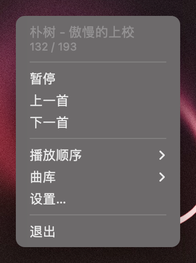

# Barplayer

一个播放本地音乐文件夹的 macOS 菜单栏音乐播放器

基于 [MyGo](https://mygo.egoist.dev/)（native UI，无 webview、无 cgo），编译出来是一个几 MB 的二进制，不占 Dock，平时也没有窗口。

[English](README.md) · 简体中文

## 它解决什么

- 音乐就放在本地文件夹里，不想为了听歌维护一个资料库。
- 文件夹内加一首、删一首，播放列表自己跟上（文件监视，不是定时扫描）。
- 菜单栏点两下就能切歌，不用把窗口翻出来。
- 点两下选不中想要的那首时，「搜索…」打开一份全部曲目的列表，光标就在搜索框里：打几个字，或者滚一滚点一首。
- 键盘上的媒体键、控制中心、全局快捷键都能用，写东西的时候不用切应用。

## 界面



「播放 / 暂停」「上一首」「下一首」「搜索」右侧显示各自的全局快捷键，符号由 macOS 自己绘制（`⌥P`、`⌥[`、`⌥]`、`⌥\`）。置空的快捷键那里什么都不显示。

第一行是正在播放那首的曲名，下面一行是它在列表里的位置。这一行点开是一个二级菜单：「不喜欢」和「在 Finder 中显示」，两项都作用于正在播放那首，也都避开了播放/暂停旁边那个容易点错的位置。

### 搜索窗口

「搜索…」打开的窗口列出整个文件夹。打开时搜索框已经有了焦点，列表停在正在播放那首；窗口关掉只是隐藏，app 仍在菜单栏里跑。

- 匹配是曲名的子串，不区分大小写，边打边过滤。
- 单击一行直接播放；在搜索框里按 `↩` 播放高亮那一行（也就是第一条匹配）。
- 搜索框为空时高亮跟着正在播放的那首走，菜单里的上一首/下一首也会带动它；一旦输入了文字，高亮由你控制。
- 位于子文件夹里的曲子，名字下面多一行目录名，同名的文件分得清。
- 单击播放之后焦点回到搜索框，所以接着打字仍然是过滤。
- `⌘W` 或红叉把窗口隐藏；快捷键再打开它，它已经在前面时再按就收起来。


## 曲库

- 只认这些扩展名：`.mp3` `.flac` `.m4a` `.aac` `.ogg` `.oga` `.wav`。
- 排序按完整路径，所以同一个子文件夹的歌自然连在一起。
- 「包含子文件夹」默认**关闭**：打开后递归扫描并递归监视，关掉后只看顶层。
- 监视用 FSEvents（`mygo.WatchFiles`），事件攒 50ms 后合并上报，收到就重扫一遍目录。214 首的重扫成本远低于做增量 diff。
- 以点开头的文件和文件夹一律忽略，`_dislike` 也一样。
- 「不喜欢」把正在播放那首挪到曲库根目录下的 `_dislike`，列表随即跳过它。文件没有被删除：在访达里就躺在那里，从里面拖回曲库它就又是普通曲目。正在出声的那首由下一首接上；暂停状态下的那首只是离开列表，不会自己开始播。
- 文件夹被改名或删除时，监视流结束，菜单显示「文件夹不可用」，重新选一次即可。

## 设置

窗口里有五项，不重复菜单里的东西：

| 项 | 说明 |
| --- | --- |
| 语言 | 跟随系统 / 简体中文 / English，切换即时生效，选择被系统记住 |
| 快捷键 | 播放暂停、上一首、下一首、搜索，点框录制、`Esc` 取消、`⌫` 置空、右侧圆圈清空 |
| 音量 | 本 app 自己的电平，0–200%，步长 10%，退出重开仍然记得。只缩放 Barplayer 的播放，系统音量键照旧改整机 |
| 登录时启动 | 默认关。macOS 13+ 需要打包后的 app，`go tool mygo dev` 下无效 |
| 在菜单栏显示曲目名 | 默认关。打开后图标右边显示当前曲名，超过 24 字截断 |

默认快捷键：`⌥P` 播放/暂停、`⌥[` 上一首、`⌥]` 下一首、`⌥\` 搜索。录制时先注销旧的全局快捷键，避免按下去同时触发播放；与系统或其他 app 冲突时保留旧值并在窗口里提示。`⌘W` 关掉当前窗口，和点红叉一样。

## 下载与安装

仅 Apple Silicon，要求 macOS 12 或更高。

1. 从 [最新版本](https://github.com/insv23/barplayer/releases/latest/download/barplayer-0.1.2-arm64.dmg) 下载磁盘映像。
2. 打开后把 **Barplayer** 拖进 `/Applications`。
3. 对照 Release 里公布的校验和检查下载：

   ```sh
   shasum -a 256 ~/Downloads/barplayer-0.1.2-arm64.dmg
   ```

   结果要和 `barplayer-0.1.2-arm64.dmg.sha256` 里的值一致。

4. **这个 app 没有用 Developer ID 签名，也没有公证**，所以 macOS 会隔离它，首次启动会被拒绝。执行一次下面这条去掉隔离标记：

   ```sh
   xattr -dr com.apple.quarantine /Applications/Barplayer.app
   ```

5. 启动后菜单栏出现一个音符图标；打开 **曲库 ▸ 选择文件夹…**，选你放音乐的那个文件夹。

`xattr` 那条命令给整个 `.app` 包去掉隔离标记。只对从本仓库下载、且校验和一致的那份执行。

## 运行

```sh
# 开发
go tool mygo dev

# 打包：build/Barplayer.app 和一个 .dmg
go tool mygo build
```

首次构建会下载 Go 1.27.3 工具链（`go.mod` 里写了版本，Go 自己切换）和依赖。

## 依赖与版本

`go.mod` 里的 MyGo 是 **main 分支的伪版本**（`v0.8.4-0.2026...`），不是 v0.8.3 发布版：发布版只带 `audio/mp3` 和 `audio/vorbis`，没有 `audio/flac`、`audio/aac`、`audio/mp4`，而这台机器的曲库里有一半是 flac。等上游发布包含这些包的版本后，换成正式 tag 即可。

`audio/aac` 是 **LGPL 2.1**（框架本体是 MIT），用来解 `.m4a` 里的 AAC-LC 和 ADTS `.aac`。不需要的话删掉 `player.go` 里那一行空导入，代价是这几个文件播不了（ALAC 仍由 `audio/mp4` 内置支持）。

## 数据

| 文件 | 内容 |
| --- | --- |
| `~/Library/Application Support/Barplayer/prefs.json` | 曲库路径、播放顺序、包含子文件夹、菜单栏曲名、app 音量、语言、四个快捷键 |
| `~/Library/Application Support/Barplayer/window-state.json` | 设置窗口与曲目窗口的位置和尺寸 |

开发运行和打包版共用这一份（`main.go` 里调了 `SetName("Barplayer")`）。想重置就删掉 `prefs.json`。

## 已知限制

- **没有标签解析**：曲名就是文件名去掉扩展名（`Artist - Title.mp3` → `Artist - Title`）。MyGo 不解码 ID3。
- **搜索只匹配曲名**：不区分大小写的子串匹配，所以 `Bjork` 搜不到 `Björk`，子文件夹名和标签字段不参与匹配。
- **音量只管本 app**：设置里的滑杆把 Barplayer 的输出从静音缩放到 200%，系统音量键仍然改整机。超过 100% 会削波：MyGo 的混音器求和后直接截到满刻度，没有限幅器，所以峰值接近 0 dBFS 的母带会有可闻的破音，100% 及以下永远干净。
- **没有封面和进度**：同上，NSMenu 只有文字、副标题、16pt 图标、勾选和快捷键提示。
- **切歌有约 100ms 间隙**：每首新开一个 player，没有预加载和淡入淡出。
- **菜单展开时快捷键不生效**：菜单开着的时候 macOS 跑自己的循环，全局热键和状态栏菜单自己的快捷键都不投递给 app。菜单收起后恢复。
- **HE-AAC（AAC+）解不了**，这类文件会被跳过。
- 未完成的下载文件（写了一半的 mp3）打开失败时会跳下一首，不会卡住。

## 文件

| 文件 | 职责 |
| --- | --- |
| `main.go` | app 状态、启动装配（托盘、窗口、媒体键、快捷键）、托盘图标、退出清理 |
| `player.go` | 播放/暂停、洗牌队列、历史栈、上下一首、单曲循环 |
| `library.go` | 扫描、文件监视、曲库变化后的续播 |
| `menu.go` | 托盘菜单构建与增量更新、菜单栏标题、应用菜单栏 |
| `search.go` | 曲目窗口：按名字过滤、行、播放某一行 |
| `settings.go` | 设置窗口、快捷键录制、语言切换、登录启动、选文件夹 |
| `prefs.go` | 偏好的读写（空快捷键是合法值，用指针解码区分「没设置」和「设成空」） |
| `i18n.go` | 中英两张字符串表 |
| `keys.go` | 键名映射（`ui.Key` 优先、`ui.KeyCode` 兜底）、accelerator 拼接、macOS 符号显示 |
| `mygo.json` | 应用名、identifier、版本、打包输出目录 |

测试清单见 [TESTING.md](TESTING.md)。
